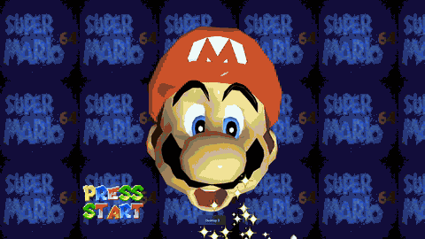

# sm64ex-fpv



Fork of [sm64pc/sm64ex](https://github.com/sm64pc/sm64ex) that lets Mario deploy an FPV quadcopter and fly it around the level.

The drone runs real Betaflight firmware through [libfpv](https://github.com/hammerill/libfpv), so rates, angle mode, arming and crashes behave like a real 5" quad. Mario stays put as the pilot while you fly with a keyboard, a gamepad or a real radio in USB joystick mode.

There must be **no upload of any copyrighted asset**. You need your own Super Mario 64 ROM to build the game.
Run `./extract_assets.py --clean && make clean` or `make distclean` to remove ROM-originated content.

## FPV drone features

 * Betaflight in the loop via libfpv: real rates, modes and filters. Betaflight Configurator can connect over `ws://localhost:5761`.
 * Collision with the whole level and with every object collision model (moving platforms, doors, Whomps...). Water and lava destroy the props.
 * The drone collects coins, stars, keys and 1-ups, and knocks out Goombas, Koopas, Bob-ombs and other enemies when it hits them fast enough.
 * FPV, chase and line-of-sight cameras with full rotation, a spherical skybox, lens distortion and analog video noise that grows with distance from Mario.
 * Betaflight OSD and the libfpv overlay (F8) for radio setup, presets, rates, camera settings and the Betaflight CLI.
 * Motor sound mixed into the game audio.
 * Rebindable drone controls in Options > Controls.
 * A scripted self-test (`SM64_FPV_TEST`) that flies a route and saves telemetry and screenshots.

### Controls

| Action | Keyboard | Gamepad |
|---|---|---|
| Deploy / recall the drone | F | Back / Select |
| Repair and respawn at the launch point | R | D-pad up |
| Camera: FPV / chase / line of sight | V | D-pad right |
| libfpv overlay | F8 | |

On the keyboard, Enter arms, W/S sets the throttle, A/D yaws and the arrow keys pitch and roll. On a gamepad (mode 2), A arms, the left stick is throttle and yaw and the right stick is pitch and roll.

See [FPV_DRONE.md](FPV_DRONE.md) for the full controls, the self-test and how the mod hooks the game.

## Building

Build [libfpv](https://github.com/hammerill/libfpv) first (see its README), then build this repo with `FPV_DRONE=1`. `LIBFPV_DIR` defaults to `../libfpv`.

```sh
# Linux or macOS
make FPV_DRONE=1
```

### Windows

Windows builds are cross-compiled from Linux (WSL works) with MinGW-w64. The commands below are for Ubuntu/Debian.

1. Install the toolchain:

   ```sh
   sudo apt install build-essential git python3 curl mingw-w64
   ```

2. Install the MinGW builds of SDL2 and GLEW into a folder of your choice (`~/mingw-deps` here). SDL2 comes from its official MinGW development package. GLEW is compiled into a static library; the headers already ship in this repo (`include/GL`), so only the library is needed:

   ```sh
   DEPS=$HOME/mingw-deps
   cd "$(mktemp -d)"
   curl -fsSL https://github.com/libsdl-org/SDL/releases/download/release-2.32.8/SDL2-devel-2.32.8-mingw.tar.gz | tar xz
   make -C SDL2-2.32.8 cross CROSS_PATH=$DEPS
   curl -fsSL https://github.com/nigels-com/glew/releases/download/glew-2.1.0/glew-2.1.0.tgz | tar xz
   x86_64-w64-mingw32-gcc -O2 -DGLEW_STATIC -DGLEW_NO_GLU -Iglew-2.1.0/include -c glew-2.1.0/src/glew.c -o glew.o
   x86_64-w64-mingw32-ar rcs $DEPS/x86_64-w64-mingw32/lib/libglew32.a glew.o
   ```

3. Build libfpv for Windows into its `build/win` folder (`build/win-kamikaze` for the [kamikaze drone](FPV_DRONE.md#building)), as its README describes.

4. Build the game:

   ```sh
   make WINDOWS_BUILD=1 CROSS=x86_64-w64-mingw32- TARGET_BITS=64 FPV_DRONE=1 \
        SDLCONFIG=$HOME/mingw-deps/x86_64-w64-mingw32/bin/sdl2-config
   ```

   Add `FPV_KAMIKAZE=1` for the kamikaze drone. Don't pass `CC`/`CXX`: they are derived from `CROSS`, and the build tools under `tools/` must stay native Linux binaries (`TOOLS_CC`/`TOOLS_CXX` choose their compiler). If they were ever built with MinGW, run `make cleantools`.

The result is `build/us_pc/sm64.us.f3dex2e.exe` with `libfpv.dll` next to it. SDL2, GLEW and the MinGW runtime are linked statically, so these two files only depend on Windows system DLLs.

### macOS app

`make FPV_DRONE=1 app` wraps the build in a double-clickable `build/us_pc/SM64EX FPV.app`. It bundles libfpv and the Homebrew SDL2 under `Contents/Frameworks`, so neither has to be installed to run it. For an icon, put any image `sips` can read (`.ico`, `.png`...) at `mac/AppIcon.<ext>` (git ignores it) or pass `APP_ICON=<path>`. The app name and version can be changed with `APP_NAME` and `APP_VERSION`. The bundle is ad-hoc signed and not notarised. It is built for the host architecture and the macOS version of the build machine. On another Mac, Gatekeeper blocks it until you right-click > Open it (or run `xattr -dr com.apple.quarantine` on it). It contains the game's assets, so don't share it.

`libfpv.dll` (or `libfpv.so.0`, or `libfpv.0.dylib` on macOS) is copied next to the executable and must ship with it. Only the OpenGL renderer draws the lens effect, the OSD and the overlay.

For everything else about building (dependencies, ROM placement, other platforms), the [sm64ex wiki](https://github.com/sm64pc/sm64ex/wiki) applies. Without `FPV_DRONE=1` the build is plain sm64ex.

## Inherited sm64ex features

 * Options menu with various settings, including button remapping.
 * Optional external data loading (so far only textures and assembled soundbanks), providing support for custom texture packs.
 * Optional analog camera and mouse look (using [Puppycam](https://github.com/FazanaJ/puppycam)).
 * Optional OpenGL1.3-based renderer for older machines, as well as the original GL2.1, D3D11 and D3D12 renderers from Emill's [n64-fast3d-engine](https://github.com/Emill/n64-fast3d-engine/).
 * Option to disable drawing distances.
 * Optional model and texture fixes (e.g. the smoke texture).
 * Skip introductory Peach & Lakitu cutscenes with the `--skip-intro` CLI option.
 * Cheats menu in Options (activate with `--cheats` or by pressing L thrice in the pause menu).
 * Support for both little-endian and big-endian save files (meaning you can use save files from both sm64-port and most emulators), as well as an optional text-based save format.

Saves and configuration live in `%APPDATA%\sm64ex` on Windows, `$HOME/.local/share/sm64ex` on Linux and `~/Library/Application Support/sm64ex` on macOS, along with the drone's `libfpv-data` folder and `fpv.log`. The save location can be changed with the `--savepath` CLI option:
`--savepath .` reads saves from the current directory, and `--savepath '!'` reads them from the executable directory.

The translated READMEs ([Español](README_es_ES.md), [Português](README_pt_BR.md), [简体中文](README_zh_CN.md), [Bahasa Melayu](README_ms_MY.md)) describe upstream sm64ex and don't cover the drone.

## Credits

 * [sm64pc/sm64ex](https://github.com/sm64pc/sm64ex) and [sm64-port](https://github.com/sm64-port/sm64-port), which this is built on.
 * [libfpv](https://github.com/hammerill/libfpv), which runs Betaflight through [SimITL](https://github.com/AJ92/SimITL).
